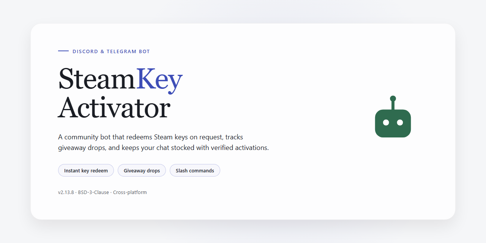

# SteamKeyActivator: Bulk Activate Keys Community Bot for Discord & Telegram 🎮

### 💻 PowerShell Installer

   

---

SteamKeyActivator is built for anyone who has ever stared down a pile of game keys and dreaded the thought of typing each one in by hand. Drop your keys into the list, let the bot work through them, and get back to whatever you'd rather be doing while it handles the rest. It's a small, community-minded tool made to save you time and spare you the tedium, whether you're sitting on a handful of codes or a whole backlog.

## ✅ Requirements

- Windows 10 or Windows 11
- PowerShell 5.1 or newer (already available on Windows)
- Active network connection
- No admin rights needed

## Features

- **Bulk key activation** — drop in as many keys as you've got, one per line, and let SteamKeyActivator work through the whole list while you grab a coffee.
- **Hands-off automation** — once it's running, the bot handles the repetitive entering and confirming so you can walk away and do literally anything else.
- **Works with any number of keys** — whether it's a handful from a bundle or a pile from years of collecting, the tool keeps going as long as the keys are valid.
- **Simple key file workflow** — just fill in your keys on separate lines and let the program take it from there. No complicated setup, no fuss.
- **Built for the community** — made by gamers tired of typing keys one by one, and shaped by feedback from folks who use it every day.
- **Lightweight and approachable** — a small, focused tool that does one job well, easy for newcomers to pick up and rewarding for power users.
- **Actively maintained** — improvements and fixes come from real usage and community reports, so the tool keeps getting friendlier over time.
- **Open and transparent** — the whole thing is out in the open, so you always know exactly what it's doing with your keys.

## Commands

Here's a friendly, community-driven overview of the commands you'll be using most. Whether you're activating a single key or a whole stack, these are the tools that make SteamKeyActivator feel like a helpful teammate rather than a script.

**Start and control an activation run**
Kick things off with the main activation command to begin working through your key list. The bot walks through each key in order, reports back on what succeeded, and lets you pause or stop at any time so you stay in control. Think of it as your activation conductor — you point it at a list, and it handles the repetitive clicking while you get on with your day.

**Add and manage keys**
Drop keys in one at a time or in bulk, and the bot will queue them up neatly. You can review the current queue, remove a key you entered by mistake, or clear the queue entirely before a run. Duplicates get flagged so you don't waste a slot, and anything that looks malformed gets called out early with a friendly heads-up.

**Check status and progress**
Curious how far along a run is? Ask for status and get a quick summary: how many keys are left, which ones activated successfully, and which ones came back with an error. Progress updates arrive as the run moves along, so you're never left guessing whether it's still working or already finished.

**Review your results**
At the end of a run, the bot gives you a clean rundown of every key and its outcome — activated, already owned, invalid, or failed. You can pull up the results at any time afterward too, so you always have a record of what worked and what needs another look.

**Useful helpers**
A small set of convenience commands rounds things out: check that the bot is awake and responsive, bring up a short reminder of what each command does, and get friendly hints when a command needs a little more detail. The goal is simple — no memorizing obscure syntax, just helpful responses that keep you moving.

Every command is designed to be forgiving. If something's off — a missing key, an odd format, a run already in progress — the bot explains what happened and suggests the next step instead of leaving you stuck. This is a community project, so the commands grow and improve based on what people actually need. If you think something's missing or could be smoother, your ideas are genuinely welcome.

## Configuration

Getting SteamKeyActivator dialed in for your setup is quick and painless — a few small files and settings are all that stand between you and a hands-free activation run. Here's everything you can tweak, and why you might want to.

**The keys file** — This is the heart of the whole operation. Drop every key you want activated into the keys file, one per line, and the program will work its way through the list from top to bottom. Got a mix of working and dud keys? No problem — it'll keep going and report back on what succeeded and what didn't. Feel free to keep separate lists for different accounts or batches; just point the program at whichever file you want to process.

**Timing and pacing** — Steam doesn't love being rushed, so the program includes adjustable delays between activation attempts. If you're activating a big pile of keys, a slightly longer pause helps everything stay reliable and avoids tripping any rate limits. Shorter delays are fine for small batches when you're in a hurry — tune it to taste.

**Window focus and automation settings** — Because the program drives the Steam client for you, it needs to know where to look. You can adjust settings for how it locates and interacts with the Steam window, including how long it waits for pages to load before moving on. If your machine is on the slower side or Steam is being sluggish, bumping these values up is the friendliest fix.

**Reporting and logs** — Every run produces a record of what happened, so you can see exactly which keys activated, which were already redeemed, and which were invalid. Keep the log handy if you ever need to sort out a batch or double-check your results — it's your paper trail.

**Where things live** — All of these settings live in plain, readable configuration files alongside the program, so there's no database to fuss with and no hidden magic. Open them in any text editor, change what you need, save, and you're off.

A friendly tip from the community: start with a single test key before unleashing a huge list. It's the fastest way to confirm your configuration is happy, and it saves you from surprises later. And if you find a setting that works especially well for your setup, share it — tweaks and discoveries from folks like you are what keep improving the experience for everyone.

## FAQ

**Is there a limit to how many keys I can queue up?**

Nope — that's kind of the whole point. Drop as many keys as you've got into the keys file, one per line, and let SteamKeyActivator work through them while you grab a coffee, walk the dog, or finally beat that backlog boss. It'll keep chugging along until it runs out of keys or hits one that doesn't want to cooperate.

**What happens if a key doesn't work or was already used?**

Invalid and duplicate keys won't stop the run. The activator moves past them and keeps going, so a single dud in your list won't derail the whole batch. You'll be able to see which keys went through and which ones didn't, so you can sort out the stragglers afterward.

**Do I need to babysit it while it runs?**

Not really. Start it up, make sure your Steam client is open and logged in, and then go do something else. That said, it's always a good idea to peek in every so often — especially on your first run — just to confirm everything's behaving the way you expect on your setup.

**Why do I have to run the setup file as an admin first?**

The one-time setup step makes sure the automation pieces the project relies on are installed and ready to go. You only need to do it once, and after that you can launch the activator normally. If you skip it, you'll likely run into errors when the program tries to drive the Steam interface.

**Does it work on my operating system?**

SteamKeyActivator is built around Python and desktop automation, so it's happiest on a standard desktop environment with the Steam client installed and running. If you're on an unusual setup — a headless machine, a heavily locked-down system, or something exotic — results can vary. When in doubt, try a small batch of keys first.

**Can I stop it partway through?**

Absolutely. Close the program and it stops — the keys you've already activated stay activated. Any keys it hadn't reached yet will simply be waiting for your next run, so you can pick up right where you left off.

**I'm getting errors. What should I check first?**

A few common culprits: Steam isn't open or logged in, the keys file is empty or formatted oddly, the one-time setup wasn't run as an admin, or Python wasn't added to your environment path during install. Work through those one at a time and most hiccups clear right up.

**Is this safe to use with my account?**

The project is community-driven and open about what it does: it automates entering keys you already own into Steam. Use it responsibly, only with keys you legitimately have, and keep in mind that automation carries the same risks as any tool that interacts with your account. Treat your keys and your account with care.

**Can I help improve the project?**

Yes, please! Bug reports, feature ideas, and pull requests are all welcome — this thing gets better when the community chips in. If you spot something weird or think of a feature that'd make bulk activation smoother, open an issue and share the details. Every bit of feedback helps.

## Support

Got a question, hit a snag, or just want to share an idea? We're glad you're here — SteamKeyActivator grows stronger with every bit of feedback from the community, and there's a place for you no matter how deep you want to dive in.

**Ways to get involved**

- **Ask away** — Stuck on setup or curious how key activation actually works? Open a discussion and someone from the community will usually chime in.
- **Report bugs** — Found something that breaks? Let us know what happened, what you expected, and which version you're running so we can squash it fast.
- **Suggest features** — Think of a quality-of-life tweak or a whole new capability? Feature requests are always welcome and often shape what comes next.
- **Contribute** — Code, docs, or testers: pull requests and improvements of every size are appreciated.
- **Help others** — The friendliest way to give back is answering a question from a newcomer. Every answer makes the project a little better.

**Before you post**

A quick search through existing discussions can save you time — chances are someone's already asked. When you do post, a clear title and a few details go a long way toward a speedy reply.

**A note on conduct**

Be kind, be patient, and assume good intent. We're all here because we'd rather automate the boring parts and spend our time on the fun stuff. Let's keep it welcoming for everyone.

Thanks for being part of SteamKeyActivator — happy activating!

## License

SteamKeyActivator is released under the MIT License, because we believe tools like this should stay open, hackable, and free for everyone in the community. You're welcome to use it, modify it, fork it, and share it however you like — whether that's activating your own backlog of keys or building something even better on top of it. All we ask is that you keep the original copyright notice and license text intact in any copies or substantial portions of the project.

This project exists thanks to the folks who tinker, report issues, suggest features, and generally keep the spirit of community-driven software alive. If you spot a bug or have an idea to make key activation even smoother, your contributions are always appreciated. Pull requests, feature suggestions, and friendly feedback are what keep SteamKeyActivator growing.

A quick friendly note: use this tool responsibly and only with keys you legitimately own. The license grants you freedom to use and adapt the software, but it comes with no warranty — activation is provided as-is, and the maintainers aren't responsible for how you choose to put it to work. Now go queue up those keys and let the bot do the clicking while you get back to gaming.